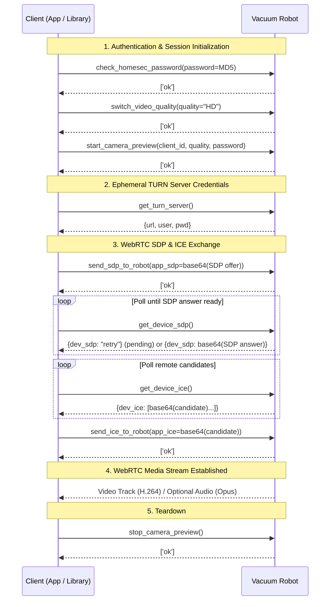

# Camera Live View Protocol (V1)

This document describes the reverse-engineered protocol for camera live streaming, WebRTC signaling, and media transport on camera-equipped Roborock V1 vacuum robots.

## Scope & Evidence

- **Protocol family**: Roborock V1 (`pv=1.0`).
- **Feature flags**: Models supporting camera features report `is_video_monitor_supported` (bit mask `8`, bit 3 of `robotNewFeatures`) in device capabilities (see [V1_DEVICE_FEATURES.md](V1_DEVICE_FEATURES.md)).
- **Tested hardware**: Roborock Qrevo Curv (model `a135`).
- **Observation source**: Captures from the Roborock mobile app session negotiation and standalone aiortc test client verification.
- **Note on model variance**: Roborock firmware and command parameters can vary across models. Unverified fields and behaviors are called out explicitly.

---

## Architecture Overview

The camera subsystem uses standard **Roborock V1 JSON-RPC for signaling** and **WebRTC for media transport**:

- **Signaling channel**: Standard Roborock protocol RPC commands carried in `dps["101"]` / `dps["102"]`, transmitted via the cloud MQTT broker (`rr/m/...`) or local TCP channel.
- **Media transport**: WebRTC PeerConnection with ICE (STUN / TURN) negotiation for low-latency video and audio streaming.



---

## Signaling Transport

Camera commands are standard Roborock V1 RPC messages. They follow the library's transport structure documented in [DEVICES.md](DEVICES.md).

### DPS Envelope Framing

In V1 protocol messages:
- **Requests**: The JSON-RPC request object is serialized to a JSON string and placed under `dps["101"]`.
- **Responses**: The device replies with a JSON-serialized result string under `dps["102"]`.
- **Transport framing**: Over MQTT, outer message protocol header is `101` and requests include a `security` block with nonce and endpoint. Over local TCP (port 58867), outer protocol is `4` and `security` is omitted.

#### Complete DPS Request Example:
```json
{
  "dps": {
    "101": "{\"id\":12345,\"method\":\"start_camera_preview\",\"params\":{\"client_id\":\"a1b2c3d4\",\"quality\":\"HD\",\"password\":\"81dc9bdb52d04dc20036dbd8313ed055\"},\"security\":{\"endpoint\":\"...\",\"nonce\":\"...\"}}"
  },
  "t": 1760000000
}
```

#### Complete DPS Response Example:
```json
{
  "dps": {
    "102": "{\"id\":12345,\"result\":[\"ok\"]}"
  }
}
```

### MQTT Topics

When signaling over the Roborock Cloud MQTT broker:

```text
Publish:   rr/m/i/{rriot_u}/{mqtt_username}/{duid}
Subscribe: rr/m/o/{rriot_u}/{mqtt_username}/{duid}
```

Where:
- `rriot_u`: User identifier from Roborock account credentials.
- `duid`: Unique device identifier of the vacuum.
- `mqtt_username`: Hashed MQTT username slice: `hashlib.md5(f"{rriot_u}:{rriot_k}".encode()).hexdigest()[2:10]`.
- Broker hostname, port, and TLS configuration are obtained directly from `rriot.r.m` (see `create_mqtt_params` in `roborock/protocol.py`).

> [!NOTE]
> `{mqtt_username}` in the topic is distinct from the `client_id` parameter passed to `start_camera_preview`. While `{mqtt_username}` authenticates the MQTT transport channel, `client_id` identifies the individual camera streaming consumer session on the robot. Clients typically pass their hashed MQTT username (or device identifier / UUID) as `client_id`; whether the robot enforces specific format constraints on this identifier is unverified.

---

## Authentication & Password Hashing

Camera viewing is protected by a separate PIN / pattern lock configured in the mobile app:

1. **Pattern conversion**: The 3x3 pattern lock points are represented as a sequence of numeric digits (e.g. `"1234"`).
2. **Hash derivation**: The password parameter is the lowercase hexadecimal MD5 digest of the UTF-8 encoded digits:
   ```python
   import hashlib

   password_hash = hashlib.md5("1234".encode("utf-8")).hexdigest()
   # Result: "81dc9bdb52d04dc20036dbd8313ed055"
   ```
3. Both `check_homesec_password` and `start_camera_preview` expect this MD5 hash.
4. An incorrect password returns an error response (e.g. `{"code": -1, "message": "password error"}`). Multiple consecutive invalid attempts may trigger a temporary security lockout on the robot.

---

## Commands Reference

See also [V1_API_COMMANDS.md](V1_API_COMMANDS.md) for general V1 device RPC references.

> [!NOTE]
> Device RPC responses in the tables below may be returned either as a single-element list (e.g. `[{"dev_sdp": "..."}]`) or as a bare dictionary (`{"dev_sdp": "..."}`), depending on firmware version. Parsers should unwrap single-element lists transparently.

### Camera Session Control

| Command | Parameters | Response Result | Description |
|---------|------------|-----------------|-------------|
| `check_homesec_password` | `{"password": "<md5_hash>"}` | `["ok"]` | Validates the camera security PIN/pattern hash. |
| `start_camera_preview` | `{"client_id": "...", "quality": "HD", "password": "<md5_hash>"}` | `["ok"]` | Activates camera preview mode on the robot. |
| `stop_camera_preview` | `[]` | `["ok"]` | Deactivates camera preview and powers down the camera sensor. |
| `switch_video_quality` | `{"quality": "HD"}` / `{"quality": "SD"}` / `{"quality": "FHD"}` / `{"quality": "auto"}` | `["ok"]` | Switches streaming resolution (`HD`, `SD`, `FHD`, or `auto`). |

### WebRTC Signaling

| Command | Parameters | Response Result | Description |
|---------|------------|-----------------|-------------|
| `get_turn_server` | `[]` | `[{"url": "turn:...", "user": "...", "pwd": "..."}]` | Retrieves ephemeral TURN relay credentials from the robot. |
| `send_sdp_to_robot` | `{"app_sdp": "<base64_json>"}` | `["ok"]` | Sends the client's local SDP offer to the robot. |
| `get_device_sdp` | `[]` | `[{"dev_sdp": "<base64_json>"}]` or `[{"dev_sdp": "retry"}]` | Polls for the robot's SDP answer. |
| `send_ice_to_robot` | `{"app_ice": "<base64_json>"}` | `["ok"]` | Forwards a client ICE candidate to the robot. |
| `get_device_ice` | `[]` | `[{"dev_ice": ["<base64_json>", ...]}]` | Polls for remote ICE candidates generated by the robot. |

### Voice Intercom (Two-Way Audio)

| Command | Parameters | Response Result | Description |
|---------|------------|-----------------|-------------|
| `start_voice_chat` | `[]` | `["ok"]` | Unblocks transmission of microphone audio packets from the robot. |
| `stop_voice_chat` | `[]` | `["ok"]` | Mutes/stops voice chat audio streaming. |

> [!NOTE]
> Even if audio transceivers are negotiated in the WebRTC SDP offer, the robot does not transmit audio media from its onboard microphone until `start_voice_chat` is called.

### Remote Driving During Live View

| Command | Parameters | Response Result | Description |
|---------|------------|-----------------|-------------|
| `app_rc_start` | `[]` | `["ok"]` | Initiates manual remote control session. |
| `app_rc_move` | `[{"velocity": 0.2, "omega": 0.0, "duration": 500, "seqnum": 1}]` | `["ok"]` | Sends motion vector (linear speed, angular speed, duration ms). |
| `app_rc_end` | `[]` | `["ok"]` | Exits manual remote control session. |

---

## SDP & ICE Payload Serialization

All SDP descriptions and ICE candidate structures exchanged in signaling are packaged as base64-encoded UTF-8 JSON strings.

### SDP Offer Packaging

The client creates a standard WebRTC SDP offer string, wraps it in JSON with `"sdp"` and `"type"` keys, and base64-encodes it:

```python
import base64
import json

sdp_obj = {
    "sdp": peer_connection.localDescription.sdp,
    "type": "offer",
}
app_sdp = base64.b64encode(json.dumps(sdp_obj).encode("utf-8")).decode("ascii")
# Parameter payload sent: {"app_sdp": app_sdp}
```

### SDP Answer Polling & Parsing

The client polls `get_device_sdp` until the answer is available:
- While pending, the robot returns `{"dev_sdp": "retry"}`.
- When ready, `dev_sdp` contains a base64 string decoding to:
  ```json
  {
    "sdp": "v=0\r\no=- ...\r\ns=-\r\n...",
    "type": "answer"
  }
  ```
- Polling should be bounded (e.g. 20–30 attempts with 200–300 ms delays).

### ICE Candidate Packaging

When using aiortc with standard vanilla ICE, local candidates are embedded directly within the initial SDP offer, making separate calls to `send_ice_to_robot` optional. Clients supporting Trickle ICE (such as the official mobile app) send individual candidates dynamically via `send_ice_to_robot`:

```python
# In aiortc: candidate_str = f"candidate:{candidate_to_sdp(candidate)}"
ice_obj = {
    "candidate": candidate_str,
    "sdpMid": candidate.sdpMid,
    "sdpMLineIndex": candidate.sdpMLineIndex,
}
app_ice = base64.b64encode(json.dumps(ice_obj).encode("utf-8")).decode("ascii")
# Parameter payload sent: {"app_ice": app_ice}
```

Remote candidates received from `get_device_ice`:
- Returns a list under `"dev_ice"`, where each element is a base64-encoded JSON string matching the above candidate structure.
- Candidates should be deduplicated by foundation/priority before injecting into the local peer connection.

### TURN Server Mapping

`get_turn_server` returns credentials mapped to `RTCIceServer`:
- `url` → `urls` (e.g. `"turn:turn-us.roborock.com:3478"`)
- `user` → `username`
- `pwd` → `credential`

---

## Media Transport & Codec Specifications

### Video
- **Codec**: H.264 (AVC) baseline / constrained baseline profile.
- **Resolution**: Dynamically switched between 1080p/720p (`HD`) and 480p/360p (`SD`).
- **Framerate**: Approximately 15–25 FPS depending on link quality.

### Audio (Two-Way Intercom)
- **Wire Codec**: Opus (negotiated via SDP offer/answer).
- **Robot Microphone → Client Speaker**:
  - Sample rate: 48 kHz.
  - Channels: Negotiated as stereo (aiortc decodes to 16-bit interleaved PCM, 960 samples per 20 ms frame). Mono audio can be extracted by taking the left channel (`audio[::2]`).
- **Client Microphone → Robot Speaker**:
  - Sample rate: 48 kHz mono Opus audio stream.
  - Frame duration: 20 ms frames (960 samples).

---

## Operational & Reliability Considerations

1. **Session Concurrency**: Roborock vacuums permit only a single active camera preview session at a time. Requests while another client (or the official app) is streaming will be rejected.
2. **NAT Traversal**: Because vacuum robots are commonly located behind residential NATs/firewalls, direct peer-to-peer ICE host/srflx candidates frequently fail. The TURN server credentials from `get_turn_server` provide essential relay connectivity.
3. **Session Teardown**: Always ensure `stop_camera_preview` is dispatched upon stream termination or error to power down the camera sensor and release the hardware session.
